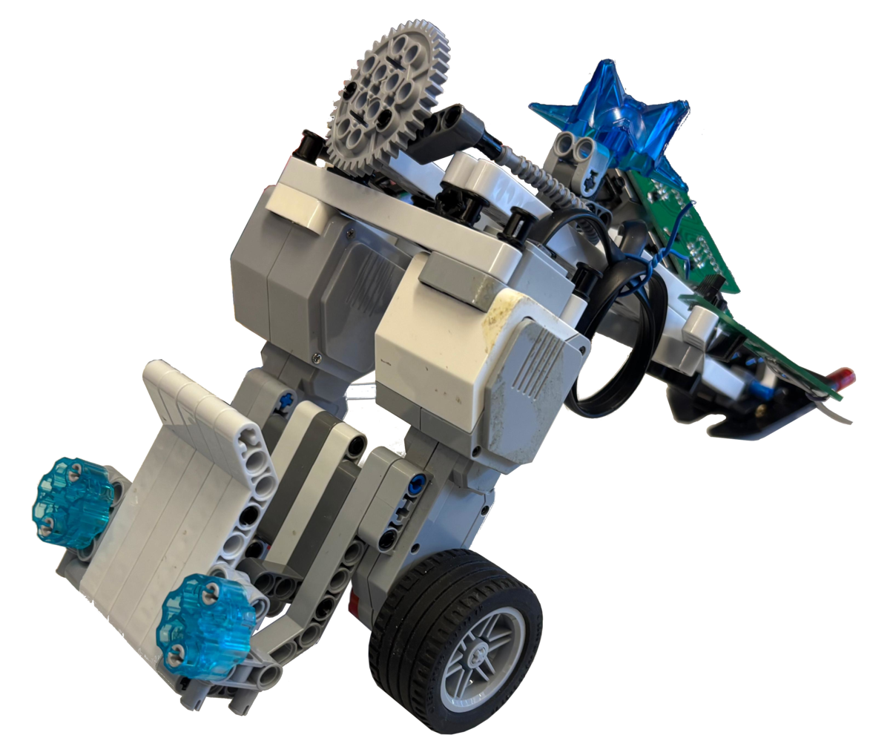
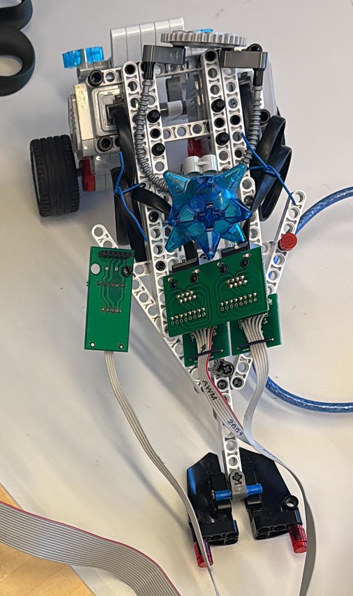
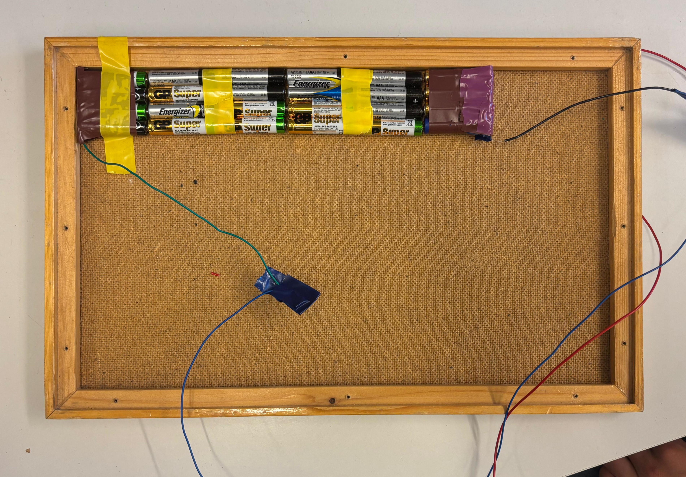
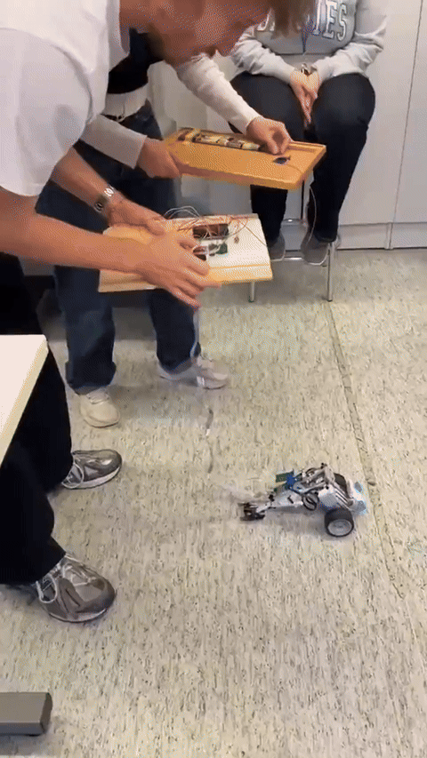
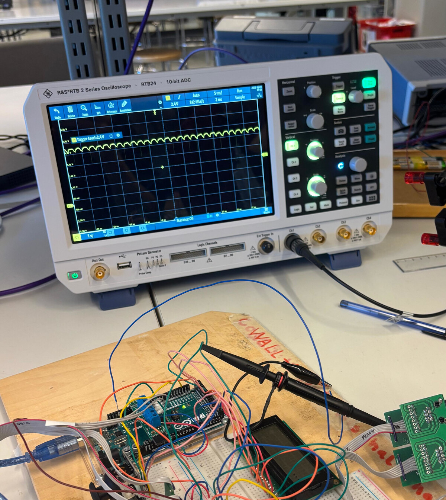
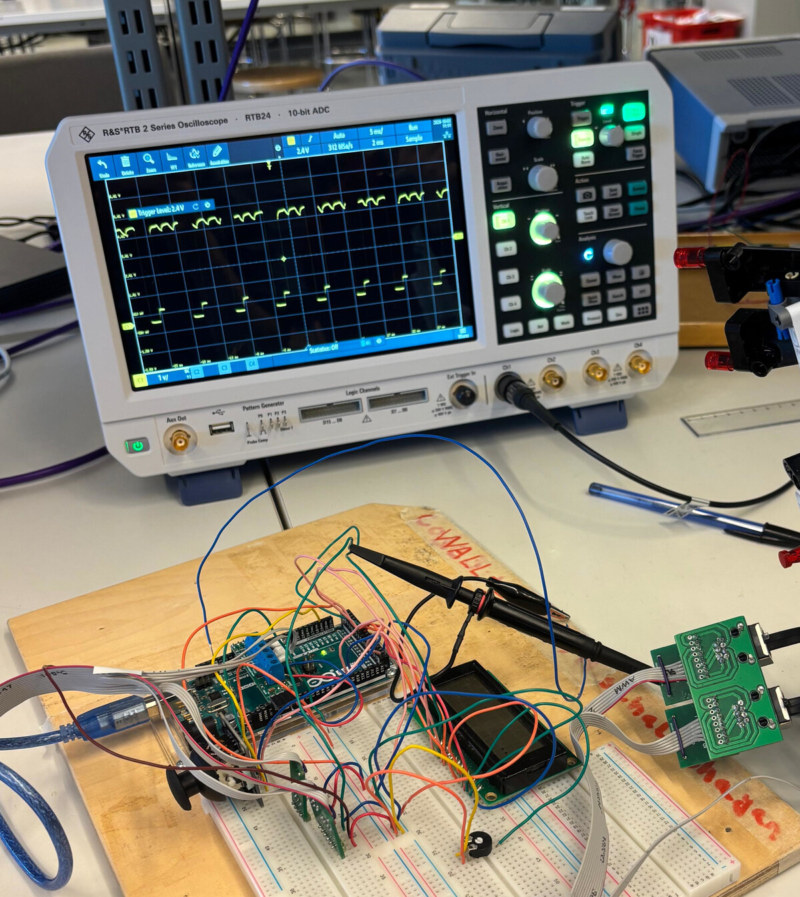
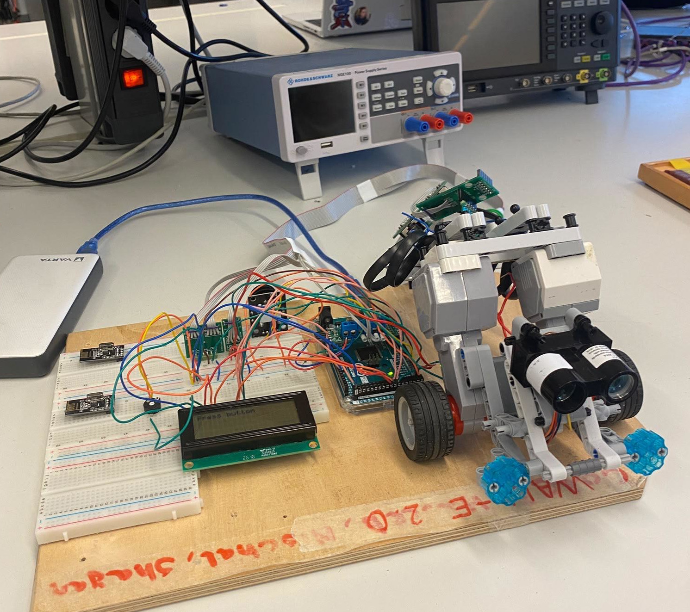
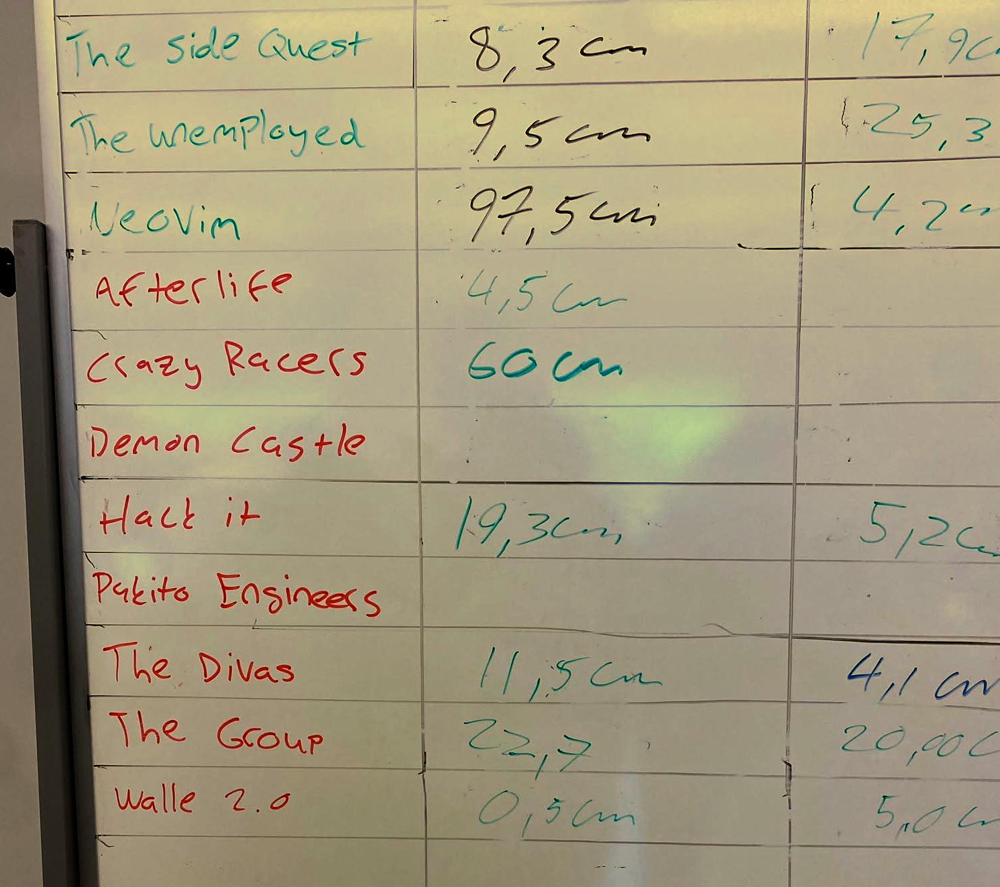
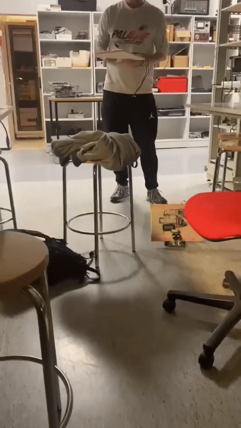

# EmbeddedProjects1

- Our group name is **WALL-E 2.0** 
- In this course we build a scrappy vehicle out of Lego in weekly exercises. 

## Project Process
<table width="100%">
    <tr>
        <td width="40%">
<ul>
    <li> First we build our Lego car with Rick as our fearless driver. The teacher told us that the wheels spin due to not enough grip is a problem for the lego cars. For this reason we mounted the motors relatively vertical to bring the weight of the motor on the tires rather than the sliding contact (to the ground) point. Later came out that spinning tires were the least of our problems. To stabilize the sliding point with the limited Legos we had, we used the "Egyptian Triangle" (3-4-5 triangle).</li>
    <li> Then we learned about the fundamentals, like analog and digital, in- and outputs. With these we were able to read the inputs from a joystick and control two motors out of a Lego Mindstorm EV3 set.</li> 
</ul>
        </td>
        <td width="60%">
<table>
    <tr>
        <td width="300">

        </td>
        <td width="170">

        </td>
    </tr>
</table>
        </td>
    </td>
</table>

- Shortly after that we prepared our car for a speed competition. For that we wrote a program using an arcade calculation to steer the vehicle only with one Joystick. 

$$
\begin{array}{ccc}
x_N \in [-1,1] \qquad &
l = y_N + x_N & \qquad
l_N = \frac{l}{max(l, r, 1)} \\
y_N \in [-1,1] \qquad &
r = y_N - x_N & \qquad
r_N = \frac{r}{max(l, r, 1)}
\end{array}
$$

---

<table>
    <tr>
        <td width="50%" align="right">

        </td>
        <td width="50%">
At the testing phase we used 3x 9V batteries in parallel on the Vin Pin of the Arduino to receive more power for the motors than using a laptops USB plug. Unfortunately the batteries were not available at the competition anymore so we build an even scrappier improvised battery with an array of AAA batteries.
        </td>
    </tr>
    <tr>
        <td align="right">

        </td>
        <td>
Sadly we couldn't achieve a really good time due to a major bug in our program that made it very hard to control. We had a 500ms delay in our control loop. Also the battery array failed on us, because the batteries had to be prushed really hard against each other to keep them connected and at the same time they needed to be perfectly aligned. Both problems can be seen in the video.
        </td>
    </tr>
    <tr>
        <td align="right">
<table>
    <tr>
        <td align="center">
            <br>
            <sub>Broken Motor</sub>
        </td>
        <td align="center">
            <br>
            <sub>Working Motor</sub>
        </td>
    </tr>
</table>
        </td>
        <td>
After that we started using encoders and interrupts with it to measure how far the vehicle drove. One of our motors had a broken encoder so we couldn't use a average value out of both. Fortunately we were allowed to use an to identify the problem, so we could see the actual voltage waveform that came from the encoders. (Later we placed one graph below the other using the Channels, but I have no photo of this)
        </td>
    </tr>
    <tr>
        <td align="right">
<table align="right">
    <tr>
        <td align="center">
            
        </td>
        <td align="center">
            
        </td>
    </tr>
</table>
        </td>
        <td>
Also we couldn't get precise results out of the working encoder. The course teacher allowed us as additional challenge to use a Lidar sensor and we were even allowed to use it in the upcoming accuracy competition. With that component we were able to achieve first place.
        </td>
    </tr>
    <tr>
        <td align="right">
</video>
        </td>
        <td>
We got the transmitter/receiver module `nRF24L01` as an optional additional challenge. Our group was able to build a scrappy but functional wireless controllable vehicle. Which was without the delay bug from before very controlable and was very fun to drive around.
        </td>
    </tr>
    <tr>
        <td>
        </td>
        <td>
- The last component we used is the compass `CMPS14` for which we used the datasheet to read the register and set the raw bits with shifts together to receive the value. After that we create a program that orients the vehicle always on the shortest way to a given direction and a program that lets the vehicle drive a given triangular path bei writing an instruction array.
        </td>
    </tr>
</table>


---
## Lidar
- We installed the library for the **Sparkfun Lite v3** lidar sensor with:
```bash
arduino-cli lib install LIDAR-Lite
```
